<div align="center">

# 🔬 SHUDDH — The People's Lab

### Your phone is already a laboratory. Shuddh turns it on.

**Is this milk watered down? Is this apple wax-polished? Is this water safe? Which crop should I sow?**<br/>
Shuddh answers with the sensors already inside your phone, an on-device AI that never uploads a thing,<br/>
and an honest "how sure we are" on every verdict.

<br/>

[](https://github.com/batmandevx/Sudh/releases/latest)
[](https://github.com/batmandevx/Sudh/releases)


**Team PICK THIS ONE** · built for the **iQOO Hackathon Grand Finale**

</div>

---

<div align="center">
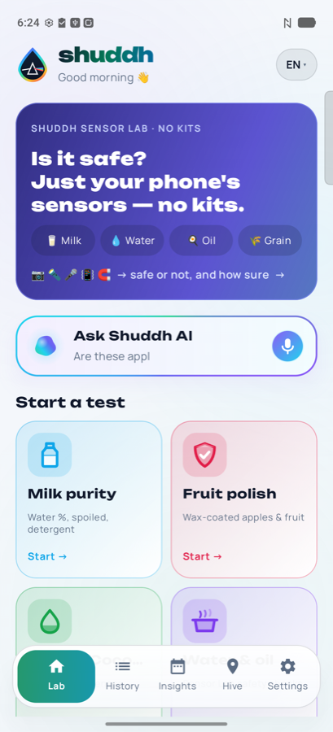
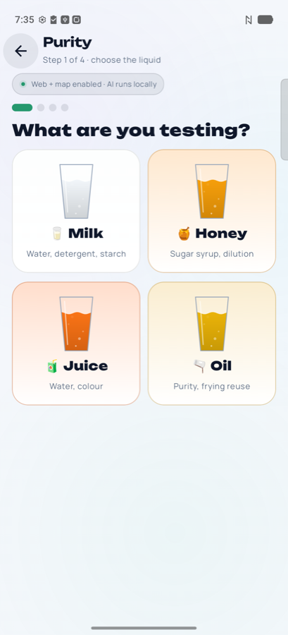
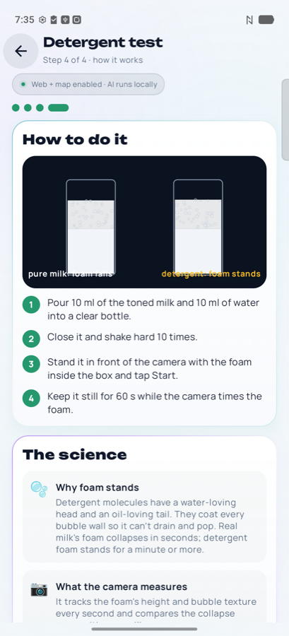
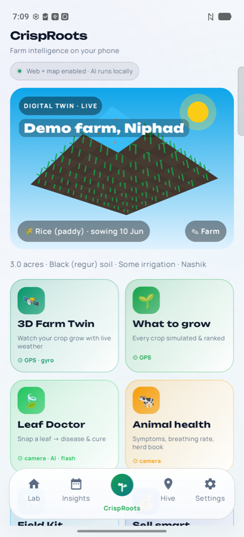
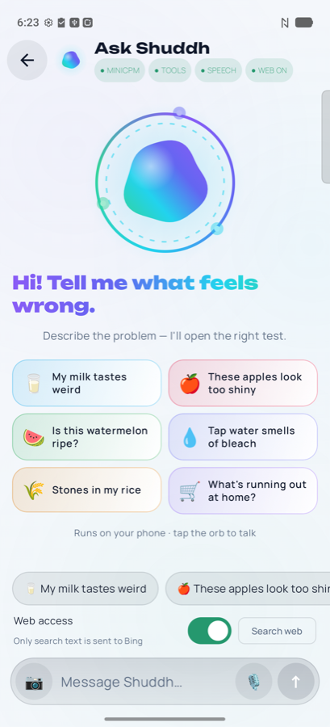
</div>

---

## 📌 Contents

[The problem](#-the-problem) · [What Shuddh is](#-what-shuddh-is-in-30-seconds) · [Architecture](#-architecture) · [Purity: how it really works](#-purity--how-a-milk-verdict-is-made) · [Every feature](#-everything-shuddh-does) · [CrispRoots](#-crisproots--a-digital-twin-of-your-farm) · [Phone hardware used](#-every-sensor-put-to-work) · [On-device AI](#-on-device-ai) · [Proof it works](#-proof--what-we-measured) · [Privacy](#-privacy) · [Build & run](#-build--run) · [Demo script](#-60-second-demo-script) · [Honest limits](#-honest-limits) · [Credits](#-credits--licences)

---

## 🌍 The problem

Food adulteration in India isn't rare. It's routine, and families have no practical way to check.

| | |
|---|---|
| **40,000+** food samples **failed** safety tests in FY 2025-26 alone, per the government's reply to Parliament | [LatestLY / Parliament](https://www.latestly.com/agency-news/business-news-over-40000-food-samples-failed-safety-tests-in-fy26-govt-tells-parliament-7530414.html) |
| **37.3%** of **milk and dairy** samples failed FSSAI standards in FY 2025-26 | [Rural Voice](https://eng.ruralvoice.in/milk-quality-concerns-deepen-37-pc-of-samples-fail-fssai-standards-in-fy26-over-11700-cases-filed) |
| **68.4%** of 1,791 milk samples were non-conforming in FSSAI's national milk survey (2011): water, detergent, starch, urea | [FoodNavigator](https://www.foodnavigator.com/Article/2012/01/10/Most-milk-sold-in-India-adulterated/) |

A lab test costs ₹500–2,000 a sample, the nearest notified lab is often hours away, and results take days. So people don't test. They trust, and hope.

**The farmer has the mirror image of this problem.** They guess what to sow, sell at the harvest glut, and lose crops to diseases and weather they could have seen coming.

---

## ⚡ What Shuddh is, in 30 seconds

Shuddh is one Android app with three pillars.

| Pillar | For | What it does |
|---|---|---|
| 🥛 **Shuddh Lab** | Every kitchen | Tests milk, honey, juice, oil, water, fruit, grain and spices with the camera, torch, speaker, microphone and magnetometer. Every verdict comes with health hazards, a PDF report and a QR code. |
| 🌱 **CrispRoots** | Every farmer | A 3D digital twin of your farm that grows your crop day by day on real weather. It also ranks crops by profit after risk, says when and where to sell, and includes a gene-trait lab, Leaf Doctor, animal health checks and a field-measuring kit. |
| 🐝 **Hive** | Every neighbourhood | An offline Bluetooth mesh that carries chat, photos, SOS and food-safety alerts phone to phone, with no internet, no SIM and no accounts. |

Two principles run through everything:

1. **No kit, no cloud.** Core tests use only the phone's own sensors, plus household items such as a dark bottle cap or a clear bottle. The AI runs on the phone, and your scans, photos and audio never leave it.
2. **Honest numbers.** Every verdict shows how sure it is, how it was measured, and what to do if it's unsure. When the evidence disagrees, Shuddh says **"Not sure — retake"** instead of guessing.

---

## 🏗 Architecture

### The whole system

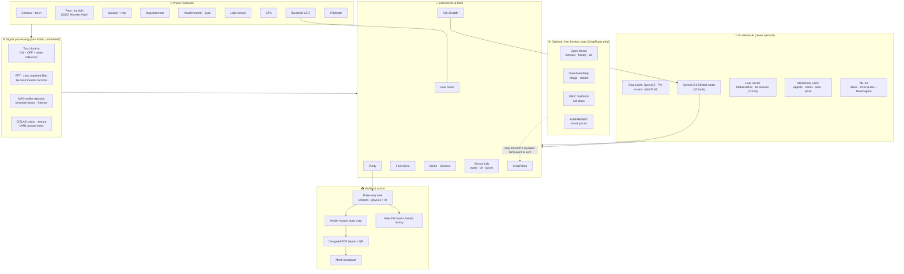

### Code map

```
app/src/main/java/com/shuddh/lab/
├── MainActivity.kt          navigation, tabs, debug hooks for demos
├── camera/                  CameraX view, ROI framing, robust RGB averaging
├── core/                    ← pure logic, no UI, unit-tested
│   ├── PurityTrain.kt       trained classifier, aim/capture checks, dilution curve
│   ├── PurityGuess.kt       light-scattering physics model (no training needed)
│   ├── PurityFusion.kt      three-way weighted vote: sensors · physics · AI
│   ├── PurityAi.kt          prompts + parsing for the on-device AI opinion
│   ├── Hazards.kt           health-hazard knowledge (organs, severity, at-risk groups, law)
│   ├── Report.kt            designed A4 PDF verdict report with QR
│   ├── FarmTwin.kt          crop simulator, weather, soil, market, back-test
│   ├── Agro.kt              crops, soils, gene traits, integrated-farming systems
│   ├── LeafDoctor.kt        TFLite plant-disease model + leaf damage %
│   ├── Livestock.kt         vet-sign checker, breathing rate, herd book
│   ├── FieldKit.kt          GPS area, slope, compass, sunlight, canopy, spray window, calendar
│   ├── Schemes.kt           12 central schemes + pre-filled application helper
│   ├── Mesh.kt              BLE advertising mesh (multi-hop, rooms, photos)
│   ├── Agent.kt             AI tool router: 37 tools, rule-first routing
│   └── … Sonar, Dsp, Kalman, WaxCheck, PantrySmart, Store (hash chain) …
├── instruments/             Purity wizard + test, Echo, Sensor Lab, Grain, Oil, Wax, Nami, …
└── ui/                      Home, CrispRoots, Insights, Hive/Mesh, Verdict, Assistant, theme
```

---

## 🥛 Purity: how a milk verdict is made

Purity is Shuddh's flagship test, and the part judges ask about most. Here's exactly what happens.

### 1 · Guided set-up (4 taps)

**Liquid** (milk / honey / juice / oil) → **milk type** (full cream, toned, double toned, skimmed, loose cow, loose buffalo…, each with its fat %) → **what to test** (water & adulteration / 🫧 detergent / 🌾 starch) → **how to do it + the science**, as animated diagrams.

### 2 · Live aiming coach

A ring fills as four checks pass: *paper in the white box · sample in the blue box · enough light · phone steady* (gyroscope). The camera boxes turn green when everything is right.

### 3 · The measurement (~25 s, narrated by voice, with haptics)

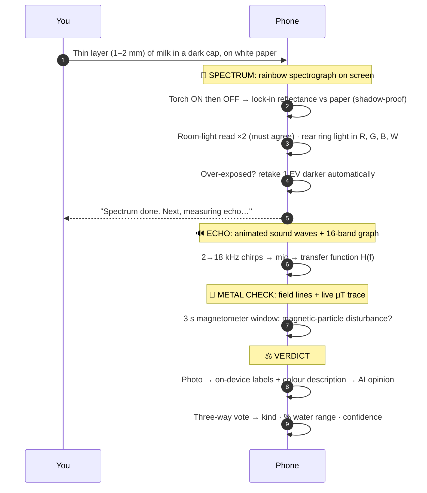

**Why a thin layer?** Milk is so opaque that in a full cap even 50 % water looks as white as pure milk: on our test phone the two read only 4 % apart. In a 1–2 mm layer, watered milk lets the dark cap show through and pure milk doesn't, so added water becomes a large, measurable signal. We found this on real samples, and the training screen warns when pure and 50/50 still look the same.

### 4 · Three independent opinions, one vote

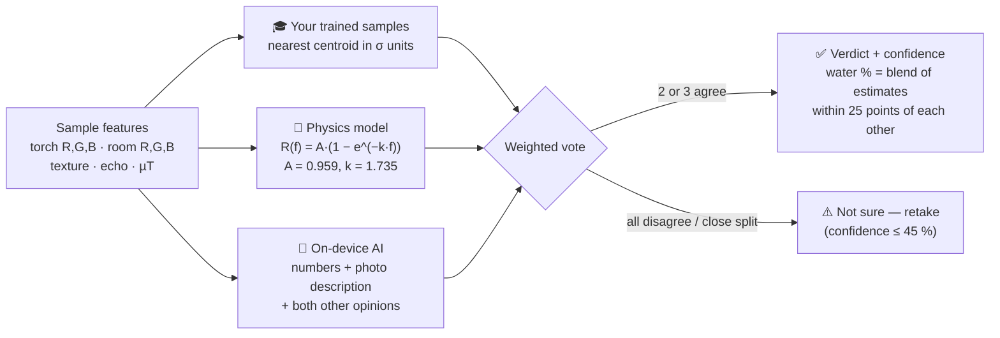

| Guard-rail | What it prevents |
|---|---|
| **Aim checks by sample type.** Milk may read up to 1.45× the paper (it's paper-bright, and the torch is brightest at the cap). Water must read dark. Honey and juice must show colour. | "Box on the paper" readings becoming training data or verdicts |
| **Impossible readings get "Retake"**, never a verdict, and are never saved as training | Garbage in, confident garbage out |
| **A kind missing compared features can't win** (missing feature = 4σ away) | A sample measured on texture alone beating real colour matches |
| **Shadowed room-light readings are dropped**, keeping the shadow-proof torch reading | The phone's own shadow ruining a good scan |
| **No training yet?** The physics model + AI give a labelled *educated guess* | An app that refuses to work out of the box |

The physics model reproduces all six reference readings stored on our test phone: pure → 0 % water, 50/50 → 50 %, water → "no milk", spoiled → spoiled, honey and juice → "not milk". These are covered by unit tests in `PurityGuessTest`.

### 5 · The verdict screen

- **⚠️ Health hazards:** an animated body map with affected organs pulsing by severity, who's most at risk (children, pregnant women, elderly), numbered "do this now" steps, and the law it breaks (FSSA 2006).
- **📄 PDF report:** a designed A4 report with verdict badge, sample, vendor, area, GPS, hazards with a body diagram, what to do, how the test works, the evidence ladder, an embedded QR code, and a tamper-check hash.
- **▦ QR code** that any Shuddh phone can scan to import the alert · **📡 Warn nearby** over the Bluetooth mesh · **💬 Send** by WhatsApp or SMS · **👪 Tell family** · **⚖️ File a complaint** with the PDF attached.

---

## 🧭 Everything Shuddh does

### 🍽 Kitchen & food safety

| Test | Phone hardware | Method | Output |
|---|---|---|---|
| **Purity** (milk, honey, juice, oil) | Camera, torch, ring light, speaker, mic, magnetometer | Lock-in reflectance + echo + µT → three-way vote | Kind, % water range, confidence, hazards |
| **Detergent in milk** | Camera | Foam height and texture timed after shaking (FSSAI lather test) | Foam collapses = pure · stands = detergent |
| **Starch in milk** | Camera + 2 drops iodine | CIELAB b* shift vs control (FSSAI DART) | Blue-black = starch |
| **Fruit Shine** (wax / polish) | Camera + flash | Specular gloss on 3 sides + optional hot-water haze, vs your unwaxed reference | Coated / natural, capped confidence |
| **Melon · Coconut** | Microphone + accelerometer | Knock FFT, resonance, ring-down; field-spot colour; dye check | Ripe / unripe · fill level |
| **Sensor Lab** | Camera, torch, mic | Water clarity, bleach dosing (EPA), H₂S germs, ORS, spice dyes (lead chromate, metanil yellow), iodised salt | Safe / caution / unsafe + confidence |
| **Grain Scan** | Camera | Blob analysis | % stones, husk, insects, broken grains |
| **Oil Check** | Camera | CIELAB browning index | Reuse count, discard advice |
| **Label Lens** | Camera + OCR | Sharpest-frame OCR, digit repair | FSSAI licence, expiry, MRP, veg mark |
| **Boil Guard · Whistle counter** | Mic, barometer | Acoustic boil detection, WHO timing; cooker pitch learning | Safe-to-drink timer · whistle alarm |
| **Smart Pantry** | — | Learns your buying rhythm, seasonal price calendar | Restock reminders, "cheapest this month" |

### 🩺 Health & family

**Anaemia screen** (nail-bed / eyelid pallor) · **Pulse** (PPG heart rate + HRV) · **Mosquito radar** (wingbeat harmonics) · **Guardian** (fall detection → 30 s check → SOS by mesh + SMS + GPS) · **Family exposure ledger** (nitrate / fluoride / arsenic vs daily limits) · **Milkman ledger** (daily litres, water-test calendar, fair monthly bill) · **Milk Watch** (learns a vendor's baseline, flags drift with CUSUM).

### 🐝 Community: Hive

- **Bluetooth mesh:** multi-hop (up to 4 hops), rooms with QR invites, live radar of nearby phones, **photos over BLE** (an ~1.5 KB thumbnail split into pieces of 105 bytes and reassembled), SOS, food alerts.
- **Vendor purity seals** (0–100 trust), **Outbreak Watch** (anonymous illness clusters vs a 14-day baseline), **batch alerts**, **Purity Beacon** for shops, **alert QR codes**. No server, no accounts.

### 🤖 Ask Shuddh

Speak or type. A **0.5B router model picks from 37 tools**: open the right test, timers, alarms, recipes with step timers, shopping list, notes, calculator, unit conversion, phone status, vendor history, PDF report, mesh broadcast, photo analysis…
**Describe a problem and it opens the right test.** For example, *"my milk tastes weird"* → Purity, *"apples look too shiny"* → Fruit Shine, *"stones in my rice"* → Grain Scan, *"tap water smells of bleach"* → Sensor Lab, each with a one-line reason.

---

## 🌱 CrispRoots: a digital twin of your farm

<div align="center">

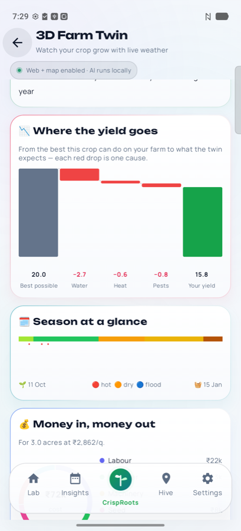
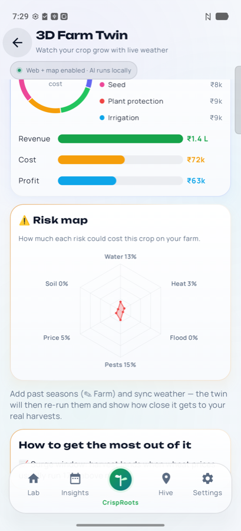
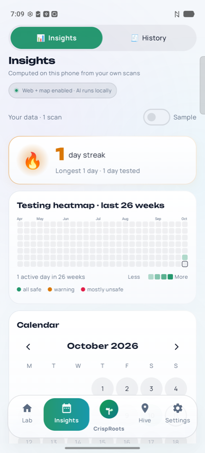
</div>

CrispRoots merges the **CrispRoots** agri-AI project into Shuddh, rebuilt to run offline on the phone.

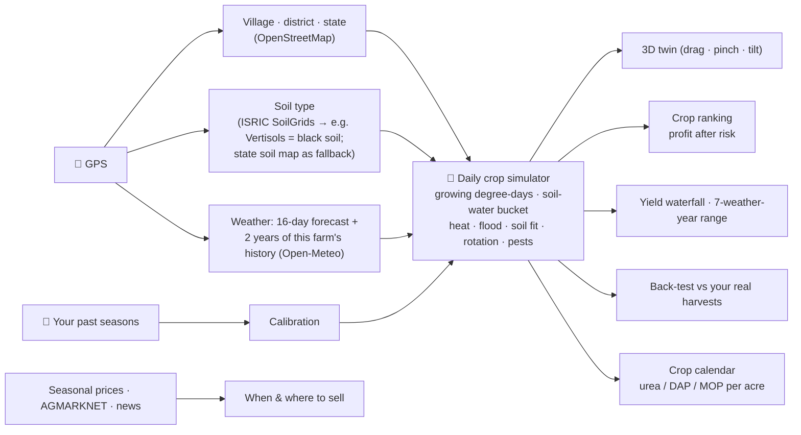

| Module | What it does |
|---|---|
| **3D Farm Twin** | Your field in 3D with a sky that follows the real clock (dawn, day, dusk, night with stars), live wind sway, drifting clouds and their shadows, birds, rain splashes, lightning, a pond with fish and an irrigation channel. Play the season day by day; drag to orbit, pinch to zoom, tilt the phone. |
| **What to grow** | Every crop simulated on *your* soil, water and weather, ranked by profit after risk. Profit-vs-risk bubble chart, price-surge tags; orchards judged on a 3-year average. |
| **How sure is this?** | The same season under 7 weather years gives a bad / likely / good-year band for yield and profit. |
| **Where the yield goes** | A waterfall from the best possible yield through each loss (water, heat, flood, soil, pests) to the twin's yield. |
| **Twin vs your harvests** | Your past seasons re-run with that year's **real archived weather**, without tuning on your yields first, then compared with what you actually harvested. This is the credibility check. |
| **Sell smart** | Best month to sell (storage losses counted, MSP floor for rice and wheat), live mandi prices ranked by market, and news signals (shortage / bumper crop → ±10 %). |
| **🧬 Gene Trait Lab** | Add a trait (Sub1 flood survival, DST drought and salt tolerance, Gn1a extra grains, Bt, …) and see the yield change in every weather scenario, plus a **CRISP fit score** for your farm. It names real seed, including India's 2025 genome-edited rice varieties DRR Dhan 100 (Kamala) and Pusa DST Rice 1. It *simulates* traits; it doesn't edit genes. |
| **🍃 Leaf Doctor** | Photograph a leaf: the on-phone AI names one of **80 crop diseases and pests**, measures % leaf damage by colour, and gives organic and chemical treatment with doses. |
| **🐄 Animal health** | Tap the signs you see: ranked diseases with urgency (FMD, lumpy skin, HS, black quarter, mastitis, milk fever, bloat, PPR, …). **Camera breathing rate** from the animal's flank. Herd book with vaccine, heat and calving dates. |
| **📡 Field Kit** | **Walk the boundary with GPS for acres and bigha** · slope (accelerometer) · row direction (compass) · sunlight and daily light (light sensor) · crop vigour (camera VARI index) · spray window and fungal-risk hours (hourly forecast) · air quality and UV. |
| **📅 Crop calendar** | Dated tasks from the simulation with exact urea / DAP / MOP doses for your acres, plus one-tap reminders. |
| **🏛 Schemes & forms** | 12 central schemes (PM-KISAN, PMFBY, KCC, PMKSY, PM-KUSUM, e-NAM, MIDH, PMMSY, NADCP, …) with "you likely qualify" and a pre-filled application sheet. |
| **🐟 Rice + fish & more** | Integrated systems (rice-fish, rice-duck, maize-cowpea, dairy + biogas, …) matched to your soil and water, with extra income per acre. |

---

## 📱 Every sensor put to work

| Hardware | Used for |
|---|---|
| **Camera** | Spectrum / reflectance, foam timing, starch colour, fruit gloss, grain, oil, leaf disease, canopy greenness, animal breathing rate, label OCR, vision lab |
| **Torch** | Lock-in illumination (ON − OFF cancels room light and shadows) |
| **Rear ring light (iQOO Monster Halo)** | Extra coloured illumination for the spectrum stage, via vivo's light API |
| **Speaker + microphone** | 2–18 kHz echo sonar (Purity, moisture), melon and coconut knock, boil detection, whistle counting, mosquito wingbeats |
| **Magnetometer** | Metal-particle check, food-grade steel check, compass for crop rows |
| **Accelerometer · gyroscope** | Steadiness gating, field slope, fall detection, 3D-farm tilt, knock detection |
| **Light sensor** | Sunlight intensity → photosynthetic light and daily light integral |
| **GPS** | Field area by walking, farm location, vendor maps |
| **Bluetooth LE 5** | Offline mesh: chat, photos, SOS, alerts, purity beacons |
| **IR blaster** | Near-infrared water check (NIR instrument) |
| **Barometer** (where present) | Altitude-adjusted boiling time |

---

## 🧠 On-device AI

| Model | Runtime | Role |
|---|---|---|
| **Qwen2.5-0.5B-Instruct** | MediaPipe LLM | Tool router: picks one of 37 tools for each request |
| **Qwen2.5-1.5B-Instruct** | MediaPipe LLM | Chat, explanations, Purity second opinion |
| **Phi-4-mini 3.8B** | MediaPipe LLM | "Pro" long-form answers and recipes |
| **MiniCPM5-2B** | LiteRT-LM | Fast multilingual chat |
| **Leaf Doctor (MobileNetV2, 80 classes)** | TensorFlow Lite | Plant disease and pest classification |
| **MediaPipe vision** | Tasks | Object detection, hands (gestures), face mesh, body pose |
| **ML Kit** | On-device | Image labels, OCR in Latin and Devanagari |

The language models are text-only. For the Purity photo check, the phone first *describes* the photo on-device (image labels, whiteness, tint, translucency, lumpiness) and sends that text to the model. Pixels never go to a server.

---

## ✅ Proof: what we measured

| Claim | Evidence |
|---|---|
| **Leaf Doctor: 85 % top-1, 98 % top-3** | 60 reference leaf photos (PlantVillage, 10 classes), run through the on-phone TFLite model. Its mistakes are mostly confusing related diseases on the same crop (e.g. tomato early vs late blight). Field photos will score lower, so the app always shows the top 3 with confidence. |
| **Purity physics model matches real readings** | Reproduces all six reference samples stored on our test phone (pure, 50/50, water, spoiled, honey, juice). `PurityGuessTest` |
| **Three-way vote fixes real failures** | A logged case where the trained matcher said "honey" for water is replayed in `PurityFusionTest` and `PurityAimTest`: physics + AI outvote it, and impossible readings are rejected. |
| **Crop twin is physically sane** | Season lengths, irrigated vs rain-fed yields, drought and heat penalties, Sub1 flood tolerance and back-testing are all asserted in `FarmTwinTest` |
| **Field Kit maths** | A 1-acre GPS square measures 1.00 ± 0.02 acres; slope, fertiliser conversion (DAP / urea / MOP), spray windows and breathing-rate detection are tested in `CrispRootsTest` |
| **Overall** | **179 unit tests, 0 failures** (`./gradlew testDebugUnitTest`) |

---

## 🔒 Privacy

- **Core tests work offline.** The AI runs on the phone; scans, photos and audio are never uploaded.
- **No accounts, no sign-up, no telemetry.** ML Kit's telemetry uploader is excluded at build time.
- **Internet is optional and narrow.** It's used only when you turn on web search, the online map, or CrispRoots weather, place, soil and mandi data. CrispRoots sends only the farm's rounded GPS point.
- **History is hash-chained** (SHA-256) on the phone, so reports are tamper-evident.
- **The mesh uses Bluetooth LE**, not Wi-Fi or the internet.

---

## 🚀 Build & run

**Easiest:** download the APK from **[Releases](https://github.com/batmandevx/Sudh/releases/latest)** and install it (allow "install unknown apps").

**From source** (JDK 17, Android SDK 35):

```bash
git clone https://github.com/batmandevx/Sudh.git && cd Sudh
./scripts/fetch_models.sh                 # public MediaPipe models → app/src/main/assets
./gradlew testDebugUnitTest assembleDebug # 179 tests, then the debug APK
adb install -r app/build/outputs/apk/debug/app-debug.apk
```

- **Leaf Doctor model:** `leaf_doctor.tflite` ships inside the release APK. Copy it from the APK's `assets/` into `app/src/main/assets/` (model files are git-ignored).
- **Optional on-device LLMs:** copy them to `/sdcard/Android/data/com.shuddh.lab/files/models/` (`shuddh-chat.task`, `shuddh-tools.task`, `shuddh-pro.task`, `shuddh-minicpm.litertlm`). See **AI models** in the app. Nothing is downloaded automatically.

**Developer hooks** (for demos):

```bash
adb shell am start -n com.shuddh.lab/.MainActivity --es screen FARM          # open any screen
adb shell am start -n com.shuddh.lab/.MainActivity --es demo_result UNSAFE   # sample verdict screen
adb shell am start -n com.shuddh.lab/.MainActivity --ez purity_fixture true  # next 5 Purity runs = scripted, badged TEST DATA
adb shell am start -n com.shuddh.lab/.MainActivity --ez purity_fixture false # switch it off
adb shell am start -n com.shuddh.lab/.MainActivity --ez light false          # dark mode
```

---

## 🎬 60-second demo script

1. **Home:** "Your phone is a lab." Tap the Ask bar and say *"my milk tastes weird"*: it opens Purity and says why.
2. **Purity:** choose milk → toned → water & adulteration. Show the animated science page. Run it on a thin layer in a dark cap: spectrum → echo → metal check → verdict.
3. **Verdict:** show the health-hazard body map, then tap **PDF report**, **QR** and **Warn nearby**.
4. **CrispRoots** (centre tab): open the 3D farm (drag, pinch, tilt), play the season, switch to *weak monsoon*, scroll the waterfall and range, and show *what to grow*.
5. **Leaf Doctor:** photograph a leaf to get the disease, damage % and treatment, all offline.
6. **Hive:** a radar of nearby phones, then send a photo over Bluetooth with no internet.

---

## 🧾 Honest limits

> We'd rather you hear these from us than find them.

- All results are **screening-grade estimates, not lab certificates.** Accuracy depends on set-up, lighting and your own calibration samples.
- **Purity needs a consistent set-up:** a thin layer in a dark cap, on white paper, at the same height for training and testing. Detergent and starch don't change how milk looks, so they need their own tests.
- **The ring-light colours** depend on vendor firmware. On our test phone the ring may only light white; the test still works with the torch.
- **CrispRoots** uses typical Indian yields, costs and 2025-26 MSP prices that adjust towards your own past harvests. The live mandi API depends on government data availability.
- **Gene Trait Lab** simulates the effect of known traits; it does not edit genes. Always buy certified seed.
- **Livestock checker** uses standard veterinary signs and gives an urgency, not a diagnosis. Call a vet for emergencies.
- **Mesh photos** are small thumbnails (BLE packets are about 200 bytes) and need Bluetooth 5.

---

## 🗺 Roadmap

- **Photoreal 3D farm** on the Filament engine, with physically based materials, HDR farm skies and photo-scanned crops (in progress).
- On-device vision-language model so the AI can look at the sample photo directly.
- Field-validated Purity accuracy across many milk brands and phones.
- Shared, privacy-preserving outbreak heat-maps for health workers.

---

## 🙏 Credits & licences

- **CrispRoots** (plant-disease model and the farm vision this work builds on)
- **Weather & air:** [Open-Meteo](https://open-meteo.com) (CC BY 4.0) · **Places:** © [OpenStreetMap](https://www.openstreetmap.org/copyright) contributors (ODbL), via Nominatim · **Soil:** [ISRIC SoilGrids](https://www.isric.org/explore/soilgrids) (CC BY 4.0) · **Mandi prices:** AGMARKNET via [data.gov.in](https://data.gov.in) (GODL-India)
- **Plant images for validation:** PlantVillage dataset · **3D assets (in progress):** [Poly Haven](https://polyhaven.com) (CC0)
- **AI:** Qwen2.5 (Apache 2.0), Phi-4-mini (MIT), MiniCPM5 (OpenBMB licence), Google MediaPipe & ML Kit, TensorFlow Lite
- **Problem statistics:** FSSAI / Government of India replies to Parliament, as reported by the linked sources

<details>
<summary><b>📖 Changelog</b></summary>

- **v5.6:** CrispRoots tab (3D twin, crop ranking, yield waterfall, weather-year range, back-test, sell smart, Gene Trait Lab with CRISP fit, Leaf Doctor, animal health, Field Kit, calendar, schemes, combos). Guided Purity wizard with detergent and starch tests, stage animations, aiming coach and educated-guess physics model. Verdict health-hazard body map, designed PDF report, QR and mesh broadcast. Mesh redesign with radar and photo sharing. History merged into Insights.
- **After v5.6:** three-way vote (sensors + physics + AI), thin-layer method, sample-type-aware aim checks, shadow-proof torch reading, automatic exposure retry, "100 % water — no milk found".
- **v5.5:** simpler Home, AI opens the right test, Fruit Shine (wax) check, smart pantry, full light/dark theme.
- **v5.4:** five-stage Purity, 0–100 calibration ladder, Milk Watch, Sensor Lab.
- **v5.3:** organised Home, Milkman Ledger, haldi lead-chromate and iodised-salt tests, MiniCPM5 on-device chat.
- **v5.1 – v5.2:** Outbreak Watch, Anaemia screen, Guardian fall detection and SOS.
- **v4.x:** on-device LLMs and tool router, Vision Lab (four MediaPipe models), Pulse, Boil Guard, Oil Check, five languages, Hive redesign, hash-chained PDF passport.
- **v2 – v3:** Bluetooth mesh, evidence ladder, corroboration engine, community seals.

</details>

---

<div align="center">

**Built in India, for every family that deserves to know what it's eating, and every farmer who deserves to know what to grow.**

*Shuddh (शुद्ध) means "pure".*

</div>
